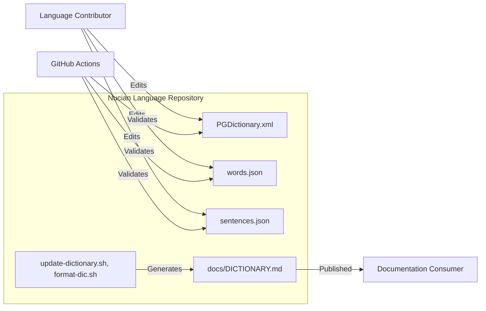
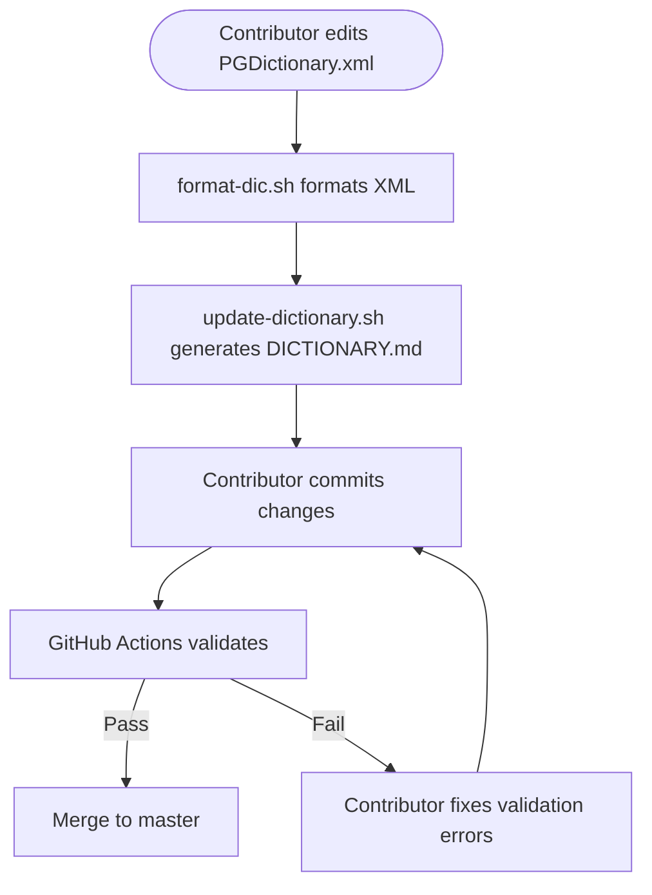
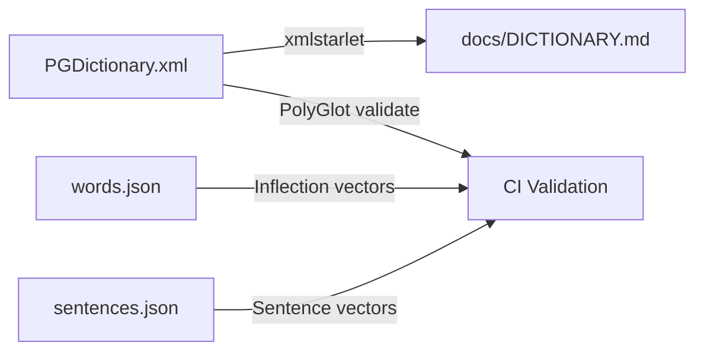
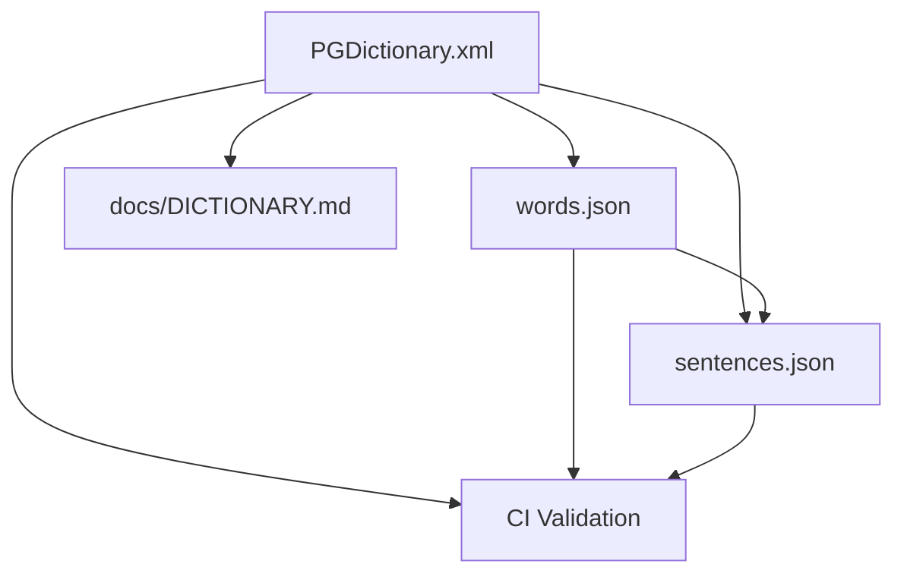

# Nucian Language Architecture

This document describes the current architecture of the Nucian Language repository, a constructed language (conlang) project maintaining the canonical Nuçian dictionary and associated validation assets.

## 📑 Table of Contents

- [Purpose](#-purpose)
- [System Context](#-system-context)
- [Architectural Style](#-architectural-style)
- [Runtime Process](#-runtime-process)
- [Architectural Areas](#-architectural-areas)
- [Data Architecture](#-data-architecture)
- [Interfaces and Integrations](#-interfaces-and-integrations)
- [Cross-Cutting Concerns](#-cross-cutting-concerns)
- [Dependency Direction and Rules](#-dependency-direction-and-rules)
- [External Dependencies](#-external-dependencies)
- [Deployment and Operations](#-deployment-and-operations)
- [Compatibility Contracts](#-compatibility-contracts)
- [Testing and Verification](#-testing-and-verification)
- [Design Constraints](#-design-constraints)
- [Source Map](#-source-map)
- [Related Documentation](#-related-documentation)

## 🎯 Purpose

This repository maintains the canonical Nuçian constructed language dictionary in PolyGlot XML format, provides lexical and sentence validation assets, and automates the generation of a human-readable Markdown dictionary. The architecture supports collaborative language development with continuous validation to ensure dictionary consistency and correctness.

## 🌐 System Context



The principal external boundaries are:
- **Language Contributor:** Edits the canonical dictionary (`PGDictionary.xml`), word inflection samples (`words.json`), and sentence corpus (`sentences.json`). Owns linguistic content.
- **GitHub Actions (CI):** Executes the PolyGlot validation workflow on every push and pull request to `master`. Validates dictionary structure, word inflections, and sentence alignment.
- **Documentation Consumer:** Reads the generated `docs/DICTIONARY.md` for human-readable dictionary output.

## 🏗️ Architectural Style

**Declarative Data Pipeline with Automated Validation**

The repository implements a declarative data pipeline where:
- The canonical dictionary (`PGDictionary.xml`) is the single source of truth for lexical entries
- Validation assets (`words.json`, `sentences.json`) provide test vectors for inflection and sentence generation
- Shell scripts transform XML to Markdown for documentation
- A GitHub Actions workflow enforces consistency via the PolyGlot validation action

Principal consequences:
- **Ownership:** Linguistic content is owned by contributors; pipeline and validation are owned by maintainers
- **Change propagation:** Dictionary edits require regeneration of `docs/DICTIONARY.md` and passing CI validation
- **No runtime:** This is a static data repository; there is no executing service or application

```mermaid
flowchart TD
    PGDict[PGDictionary.xml\n(Canonical Source)] -->|xmlstarlet extraction| GenDict[update-dictionary.sh]
    GenDict -->|Markdown table| Docs[docs/DICTIONARY.md]
    PGDict -->|xmllint formatting| Format[format-dic.sh]
    Format -->|Formatted XML| PGDict
    PGDict -->|PolyGlot validation| CI[GitHub Actions]
    Words[words.json] -->|Inflection vectors| CI
    Sentences[sentences.json] -->|Sentence vectors| CI
```

The principal architecture boundaries are:
- **Canonical Dictionary (`PGDictionary.xml`):** Single source of truth for all lexical entries, parts of speech, and language properties. All other artefacts derive from or validate against this file.
- **Validation Assets (`words.json`, `sentences.json`):** Independent test vectors that must remain aligned with dictionary entries. Owned by contributors alongside dictionary edits.
- **Generation Scripts (`update-dictionary.sh`, `format-dic.sh`):** Stateless transformers with no persistent state. Owned by maintainers.
- **Generated Documentation (`docs/DICTIONARY.md`):** Derived artefact, never edited directly. Regenerated on demand.

## 🔄 Runtime Process



The principal runtime sequence is:
1. **Edit:** Contributor modifies `PGDictionary.xml`, `words.json`, or `sentences.json`
2. **Format:** Contributor runs `format-dic.sh` to normalise XML formatting
3. **Generate:** Contributor runs `update-dictionary.sh` to regenerate `docs/DICTIONARY.md`
4. **Validate:** GitHub Actions executes `hmlendea/polyglot-language-validate@v1.0.0` against all three data files
5. **Merge:** On validation success, changes merge to `master`

## 🗂️ Architectural Areas

### Canonical Dictionary

Paths:
- `PGDictionary.xml`

Responsibilities:
- Defines language properties (name, alphabet order, font settings, author metadata)
- Declares parts of speech with mandatory definition/pronunciation rules and patterns
- Contains all lexical entries with conWord, localWord, wordTypeId, definition, pronunciation, and etymology

Boundary rules:
- Must conform to PolyGlot XML schema (version 3.5.1)
- All `wordTypeId` values must reference a declared `classId` in `partsOfSpeech`
- Definitions use HTML encoding for special characters
- Alphabet order defines sorting and is immutable without migration

### Validation Assets

Paths:
- `words.json`
- `sentences.json`

Responsibilities:
- `words.json`: Provides word-level inflection test vectors with dimensions (tense, number, persona, case, article)
- `sentences.json`: Provides sentence-level corpus mapping constructed sentences to local language equivalents

Boundary rules:
- Every `Id` in `words.json` must correspond to a valid dictionary entry or inflection form
- Every `Words` reference in `sentences.json` must resolve to entries in `words.json`
- `ConstructedLanguageSentence` must be generatable from dictionary entries

### Generation Pipeline

Paths:
- `update-dictionary.sh`
- `format-dic.sh`

Responsibilities:
- `format-dic.sh`: Pretty-prints `PGDictionary.xml` using `xmllint`
- `update-dictionary.sh`: Extracts lexical entries via `xmlstarlet` and emits Markdown table

Boundary rules:
- Scripts are stateless and idempotent
- `update-dictionary.sh` depends on `xmlstarlet` and `sed` (POSIX)
- `format-dic.sh` depends on `xmllint` (libxml2)
- Generated `docs/DICTIONARY.md` is never committed directly by CI; contributors regenerate locally

### CI Validation

Paths:
- `.github/workflows/validate.yml`

Responsibilities:
- Runs `hmlendea/polyglot-language-validate@v1.0.0` on push/PR to `master`
- Validates dictionary structure, word inflections, and sentence alignment

Boundary rules:
- Validation action is a third-party GitHub Action maintained externally
- Workflow runs on `ubuntu-latest`
- Failure blocks merge; no auto-fix capability

## 💾 Data Architecture



| Data or Store | Owner | Representation and Storage | Lifecycle or Consistency |
|---------------|-------|----------------------------|--------------------------|
| `PGDictionary.xml` | Contributors | PolyGlot XML v3.5.1; UTF-8; HTML-encoded definitions | Append-only growth; entries never deleted; formatted by `format-dic.sh` on every edit |
| `words.json` | Contributors | JSON array of objects with `Id`, `LocalWord`, `PartOfSpeechName`, `Dimensions` | Extended with dictionary; each entry validates against a dictionary word |
| `sentences.json` | Contributors | JSON array of objects with `Id`, `Words`, `ConstructedLanguageSentence`, `LocalLanguageSentence` | Extended with dictionary; `Words` references must resolve to `words.json` IDs |
| `docs/DICTIONARY.md` | Generated | Markdown table with columns: Word, Class, Translation, Definition | Regenerated on demand by `update-dictionary.sh`; never edited directly |

## 🔌 Interfaces and Integrations

| Interface or Integration | Direction | Contract | Owner | Failure Semantics |
|--------------------------|-----------|----------|-------|-------------------|
| `PGDictionary.xml` (PolyGlot format) | Inbound (editor) / Outbound (validator, generator) | PolyGlot XML v3.5.1 schema; `classId`/`wordTypeId` referential integrity | Contributors | Validation action fails CI; generation script produces malformed output |
| `words.json` | Inbound (editor) / Outbound (validator) | JSON array; `PartOfSpeechName` matches `className` in dictionary; `Dimensions` object keys are open-ended | Contributors | Validation action fails CI on unresolved IDs or dimension mismatches |
| `sentences.json` | Inbound (editor) / Outbound (validator) | JSON array; `Words` space-separated IDs referencing `words.json` | Contributors | Validation action fails CI on unresolved word IDs |
| `hmlendea/polyglot-language-validate@v1.0.0` | Outbound (CI consumption) | GitHub Action; inputs: `polyglot_dictionary_file_path`, `words_file_path`, `sentences_file_path` | External (hmlendea) | Workflow fails; no fallback; manual intervention required |
| `xmlstarlet` | Outbound (generation) | CLI XML query tool; XPath 1.0 | System package | Generation script fails; no fallback |
| `xmllint` | Outbound (formatting) | CLI XML formatter (libxml2) | System package | Formatting script fails; no fallback |

## 🧵 Cross-Cutting Concerns

### Configuration

| Configuration Area | Source | Responsibility | Supersede or Secret Policy |
|--------------------|--------|----------------|---------------------------|
| PolyGlot dictionary version | `PGDictionary.xml` → `PolyGlotVer` element | Determines schema compatibility | Fixed in XML; no supersede |
| Language alphabet order | `PGDictionary.xml` → `languageProperties/alphaOrder` | Defines sorting and character set | Fixed in XML; no supersede |
| Parts of speech catalogue | `PGDictionary.xml` → `partsOfSpeech/class[]` | Defines valid `wordTypeId` values | Fixed in XML; no supersede |
| CI workflow trigger | `.github/workflows/validate.yml` → `on.push.branches`, `on.pull_request.branches` | Controls when validation runs | Repository settings; no secrets |

### Concurrency and Resource Use

- No concurrent execution concerns: scripts are run sequentially by a single contributor
- CI runs on GitHub-hosted runners with default resource limits
- No shared state, locks, or resource pooling

## 🧭 Dependency Direction and Rules



The principal dependency rules are:
- `PGDictionary.xml` is the root dependency; all other data files and generated outputs depend on it
- `words.json` entries must reference valid `wordTypeId` values from `PGDictionary.xml`
- `sentences.json` `Words` references must resolve to `words.json` `Id` values
- `docs/DICTIONARY.md` is derived exclusively from `PGDictionary.xml` via `update-dictionary.sh`
- CI validation depends on all three data files simultaneously
- No reverse dependencies: generated artefacts never influence canonical sources
- External dependency (`hmlendea/polyglot-language-validate`) is invoked by CI only; no local installation

## 📦 External Dependencies

| Dependency | Responsibility | Integration Boundary | Architectural Consequence |
|------------|----------------|----------------------|---------------------------|
| `hmlendea/polyglot-language-validate@v1.0.0` | Validates dictionary structure, inflection consistency, and sentence alignment | GitHub Actions workflow step | CI failure blocks merge; version pinning required; no local equivalent |
| `xmlstarlet` | XPath extraction for Markdown generation | `update-dictionary.sh` shell command | Must be present in CI and contributor environments; no fallback |
| `xmllint` (libxml2) | XML pretty-printing | `format-dic.sh` shell command | Must be present in CI and contributor environments; no fallback |
| `sed`, `grep` (POSIX) | Text processing in generation pipeline | `update-dictionary.sh` shell command | Universally available on POSIX systems |

## 🚀 Deployment and Operations

| Concern | Current Design | Architectural Consequence |
|---------|----------------|---------------------------|
| Process topology | Static repository; no running services | Zero operational overhead; no scaling concerns |
| Deployment model | Git push to `master` triggers CI; documentation generated locally | Contributors control publication timing; no automated deployment |
| Persistent state | `PGDictionary.xml`, `words.json`, `sentences.json` in Git | Full history and audit trail; no external database |
| Filesystem requirements | POSIX shell, `xmlstarlet`, `xmllint` | Contributors need Linux/macOS/WSL; Windows requires WSL or Git Bash |
| Startup/shutdown | N/A (no services) | N/A |
| Operator-visible outputs | `docs/DICTIONARY.md` (Markdown), CI pass/fail badge | Documentation consumers read Markdown; maintainers monitor CI |

## 🛡️ Compatibility Contracts

| Contract | Owner | Invariant | Verification | Change Policy |
|----------|-------|-----------|--------------|---------------|
| PolyGlot XML schema v3.5.1 | Contributors | `PGDictionary.xml` validates against PolyGlot 3.5.1 expectations | `hmlendea/polyglot-language-validate` | Schema upgrades require coordinated migration of all entries |
| `classId` ↔ `wordTypeId` referential integrity | Contributors | Every `wordTypeId` in `lexicon/word` exists as `classId` in `partsOfSpeech/class` | CI validation | New parts of speech added to `partsOfSpeech` before use in `lexicon` |
| `words.json` `Id` ↔ `sentences.json` `Words` | Contributors | Every token in `sentences.json` `Words` exists as `Id` in `words.json` | CI validation | New words added to `words.json` before use in sentences |
| `words.json` `PartOfSpeechName` ↔ dictionary `className` | Contributors | Every `PartOfSpeechName` matches a `className` in `partsOfSpeech` | CI validation | New parts of speech require dictionary and validation asset updates |
| Markdown dictionary format | `update-dictionary.sh` | Output always has header `| Word | Class | Translation | Definition |` and pipe-delimited rows | Visual inspection of `docs/DICTIONARY.md` | Script changes require regeneration and review |

## ✅ Testing and Verification

The repository uses a single validation layer executed in CI:

- **PolyGlot Language Validation** (`.github/workflows/validate.yml`): Runs `hmlendea/polyglot-language-validate@v1.0.0` against `PGDictionary.xml`, `words.json`, and `sentences.json`. Verifies:
  - Dictionary XML well-formedness and schema adherence
  - Referential integrity between `wordTypeId` and `classId`
  - Word inflection dimensions in `words.json` against dictionary entries
  - Sentence word references in `sentences.json` against `words.json`
  - Constructed language sentence generatability

Execute the principal automated verification with:

```bash
# No local equivalent; validation runs only in GitHub Actions via:
# hmlendea/polyglot-language-validate@v1.0.0
```

Manual verification:
- Run `bash ./format-dic.sh` to normalise XML formatting
- Run `bash ./update-dictionary.sh` to regenerate `docs/DICTIONARY.md`
- Inspect `docs/DICTIONARY.md` for formatting correctness

Material coverage gaps:
- No unit tests for generation scripts (`update-dictionary.sh`, `format-dic.sh`)
- No schema validation of `PGDictionary.xml` against a formal XSD
- No round-trip test (Markdown → XML)
- No performance or size benchmarks for dictionary growth

## ⚠️ Design Constraints

- **PolyGlot XML version lock:** Dictionary tied to PolyGlot 3.5.1; upgrading requires migration of all entries and validation action compatibility
- **HTML-encoded definitions:** Definitions use HTML entities (`<`, `>`, `<br>`) requiring entity decoding for plain-text use
- **Alphabet order immutability:** `alphaOrder` defines sorting; changing it invalidates existing lexical ordering
- **No deletion policy:** Lexical entries are never removed from `PGDictionary.xml`; only appended
- **Single-language target:** `langPropLocalLangName` fixed to English; multi-language support would require structural changes
- **POSIX shell dependency:** Generation scripts require `xmlstarlet`, `xmllint`, `sed`, `grep`; not portable to Windows without WSL/Git Bash
- **External validation action:** CI depends on `hmlendea/polyglot-language-validate@v1.0.0`; no local fallback or alternative validator

## 🗺️ Source Map

| Area | Path |
|------|------|
| Canonical Dictionary | `PGDictionary.xml` |
| Word Inflection Vectors | `words.json` |
| Sentence Corpus | `sentences.json` |
| Dictionary Generation | `update-dictionary.sh` |
| XML Formatting | `format-dic.sh` |
| CI Validation Workflow | `.github/workflows/validate.yml` |
| Generated Documentation | `docs/DICTIONARY.md` |
| Font Assets | `conLangFont/`, `localLangFont/` |
| Project Documentation | `README.md`, `CONTRIBUTING.md`, `LICENSE` |

## 📚 Related Documentation

- [README.md](./README.md) — Project overview, usage instructions, and contribution guidelines
- [CONTRIBUTING.md](./CONTRIBUTING.md) — Detailed contribution workflow, coding standards, and pull request requirements
- [docs/DICTIONARY.md](./docs/DICTIONARY.md) — Generated human-readable dictionary (regenerated from `PGDictionary.xml`)
- [LICENSE](./LICENSE) — GNU General Public License v3.0 terms